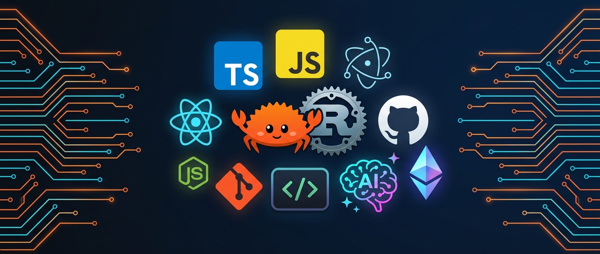

  

  

  <a href="https://github.com/buynao">
    <picture>
      <source media="(prefers-color-scheme: dark)" srcset="https://github-readme-stats.vercel.app/api?username=buynao&show_icons=true&count_private=true&theme=github_dark&hide_border=false" />
      <source media="(prefers-color-scheme: light)" srcset="https://github-readme-stats.vercel.app/api?username=buynao&show_icons=true&count_private=true&theme=default&hide_border=false" />
      
    </picture>
  </a>

  
  
  

  我是 <a href="https://github.com/buynao">Law</a>，来自武汉的开发者。关注前端、AI、Web3 与 Rust，热爱构建交互式学习工具与有趣的产品。

  I'm <a href="https://github.com/buynao">Law</a>, a developer based in Wuhan. Passionate about Frontend, AI, Web3, and Rust — building interactive learning tools and sharing along the way.

